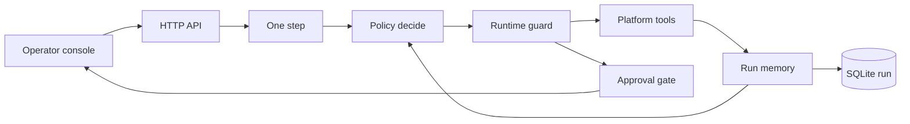

# Incident Desk

An on-call investigator for a platform engineer. It drafts a plan, calls tools, recovers when a call misses, updates a hypothesis from the evidence, and **stops before it changes production**. An operator watches every step and is the only one who can approve a rollback or a volume expand.

The default policy does not need an API key. A second policy can sit in the same slot and call an OpenAI-compatible model. Both are wrapped by the same guards.

```bash
python3 -m venv .venv
.venv/bin/python -m pip install -e ".[dev]"
.venv/bin/python -m pytest -q
.venv/bin/python -m uvicorn incident_desk.main:app --reload --port 8787
```

`make setup`, `make test`, and `make dev` do the same thing. Open http://127.0.0.1:8787. Interactive API docs are at http://127.0.0.1:8787/docs.

`make demo` prints both investigations in the terminal.

## Use case

The first fifteen minutes of an incident are a search, not a chat. The page names a metric that is not in the catalog. The window on the alert is not a window the metrics store keeps. A caller deployed recently and looks guilty. The runbook is useful only after the logs and the dependency have been read.

Incident Desk automates that search for two planted pages:

| Incident | What is actually wrong | What the agent must not do |
| --- | --- | --- |
| `inc-1042` payments-api charge errors at 18% | `2.14.3` cut the ledger client timeout from 800ms to 50ms, 18 minutes before the page | Blame the edge rate-limit reload, or restart a healthy ledger |
| `inc-1077` ledger consumer lag | The disk is at 97% and flushes fail with "no space left" | Roll back a verbosity-only deploy from 90 minutes ago |

The platform is a fixture with a frozen clock, so a review does not need cloud credentials. The investigator does not branch on the incident id. Swap `Platform` for Datadog, Kubernetes, and a deploy service later; the loop, the stored run, and the approval gate stay.

## Watch a run

1. Leave the policy on **evidence-gap**. Click **Charge error rate is 18%**.
2. Press **Run until it needs you**, or **Step** if you want one thought at a time.
3. The timeline should show, in order: the alert window `10m` rejected and retried at `15m`; the edge deploy opened as a lead and then closed because its error rate stayed at baseline; a log search for `HighErrorRate` that misses, then a search for `timeout` that hits; a healthy ledger snapshot; runbook `RB-PAY-7`; a proposal to roll `payments-api` back to `2.14.2`.
4. **Approve**. The agent still has not declared success. Step once. It re-reads the series and resolves only if the elevated metrics fell.
5. Open the ledger incident. The same loop proposes `expand_volume`, and it marks the verbosity deploy as not the cause. It does not roll anything back.

Two interventions worth trying on the charge incident:

- **Reject** the rollback and write a note. The next step asks you what to do, because that action is now banned.
- Answer with `expand the volume`, then approve it. The expand does not move the charge error rate. Verification fails, the action is banned, and the run stops for guidance instead of pretending the incident is over.
- **Pause**, refresh the browser, **Resume**, and step. The run is a SQLite document. A new process reads the same steps and continues.

Approving a made-up version (the API will accept a tampered `to_version`) does not leave the gate. The platform returns the real previous version and the proposal stays open.

## API

| Method | Path | What it does |
| --- | --- | --- |
| `GET` | `/api/incidents` | Pages the desk can open |
| `GET` | `/api/tools` | Tool catalog, including which calls mutate and which require approval |
| `POST` | `/api/runs` | `{ "incident_id", "policy": "heuristic" \| "llm" \| "auto" }` |
| `GET` | `/api/runs` and `/api/runs/{id}` | Summaries, or the full run: plan, events, hypotheses, memory, overlay |
| `POST` | `/api/runs/{id}/advance` | One step. Returns `{ applied, reason, run }` |
| `POST` | `/api/runs/{id}/pause` and `/resume` | Park a run and pick it up later, including across a process restart |
| `POST` | `/api/runs/{id}/intervene` | `{ "kind": "approve" \| "reject" \| "hint", "note" }` |

`execute_remediation` is in the tool catalog and is not in the set the loop is allowed to call. Approval is what invokes it.

`AGENT_POLICY=auto` uses the LLM policy when `OPENAI_API_KEY` is set, otherwise the evidence-gap policy. `OPENAI_BASE_URL` and `AGENT_MODEL` (default `gpt-4o-mini`) select the model. `INCIDENT_DESK_DB` moves the SQLite file (default `incident_desk.sqlite` in the working directory).

## Design



**One step is the unit of autonomy.** A step is a thought plus at most one tool call, then a save. The console can run steps until the status is `awaiting_approval`, `awaiting_input`, `paused`, `resolved`, or `failed`. Closing the laptop does not lose the place.

**The policy picks the next tool. The runtime owns the conclusion.** `derive_hypotheses` scores the tool results. A model cannot announce "confidence 0.95" and have the desk believe it. The charge page only becomes a supported rollback once the timeout deploy, the timeout series, the timeout logs, a healthy ledger, and runbook `RB-PAY-7` are all in memory. Until the ledger snapshot exists, that hypothesis is capped below the proposal line and its wording says the dependency is still unchecked.

**The next call comes from gaps, not from a script per incident.** Missing catalog, missing snapshot, a caller with a recent deploy, an empty log query, a named dependency, a missing runbook. The ledger page never queries the edge tier, because that caller did not deploy inside the window. The charge page does, and then drops the lead.

**Recovery is a reaction to the tool, not a planted exception.** The alert says `10m`. The store keeps `5m`, `15m`, and `1h`. The agent retries at `15m`, the shortest window that still covers the page. The first log query is the alert title, which is not in the log text. The next query is a word taken from the snapshot (`timeout` or `disk`). The same failed arguments are not sent again. `execute_remediation` from a policy is rewritten into a safe next step.

**A bad metric name is not used as a fake failure.** After `get_service`, the catalog is known, so the agent does not query `http_error_ratio` or `queue_lag` just to be seen failing. It snapshots the series the service actually exports.

**Humans approve effects, not the investigation.** Reject bans that action. A hint can name `rollback`, `expand the volume`, or `restart`, and that becomes the next proposal, still unapproved. Verification re-reads the series that were elevated. If they are still elevated, the action is banned and the incident is not marked resolved.

The LLM policy is the same `decide()` shape. If the call errors, the JSON is unusable, or the key disappears, that step is taken by the evidence-gap policy and the timeline says so. The plan itself stays the six-step template so the operator can see progress even when the model is choosing tools.

## Layout

- `incident_desk/fixtures.py` — catalog, two scenarios, the fixes a real remediation would produce
- `incident_desk/world.py` — tool behavior and per-run overlay
- `incident_desk/reasoning.py` — window choice, log broadening, hypothesis scores
- `incident_desk/policy.py` — evidence-gap policy and the OpenAI-compatible policy
- `incident_desk/loop.py` — step, guard, approve, verify
- `incident_desk/store.py` — one SQLite row per run
- `incident_desk/static/` — operator console

## What's next

- Point each tool method at a real system, and keep the overlay idea as a dry-run flag.
- Require a second person, or a named on-call identity, on `approve`.
- Keep a set of saved traces and score the LLM policy against them: did it recover from `10m`, did it drop the edge lead, did it refuse to execute.
- Let a run span more than one service page without starting over, when the verification proves the first proposal was aimed at the wrong tier.
