# Requirements traceability matrix

Source: `requirement.txt` (Engineering Assessment — Candidate Messaging).
Checked against the `incident_desk` package, `README.md`, `AI_TRANSCRIPT.md`, `tests/test_agent.py`, and the working tree.

Test run on 3 Nov 2026: `pytest` — 11 passed. The terminal shot is `docs/rtm/pytest.png`.
Git check: this folder is not a git repository and has no remote.

Proof shots are in `docs/rtm/`. The README setup block, the public repo, and git history were not photographed.

## Summary

Planning, tools, recovery, the approval gate, resumable SQLite state, the operator console, the runtime API, and the AI build log are in place. Two deliverables are still absent: a public GitHub repository and a git history.

## Matrix

| ID | Requirement | Evidence | Proof |
| --- | --- | --- | --- |
| REQ-01 | Agent written in Python or TypeScript | Python package `incident_desk`. FastAPI app, pytest suite, `pyproject.toml` requires Python >= 3.11. | 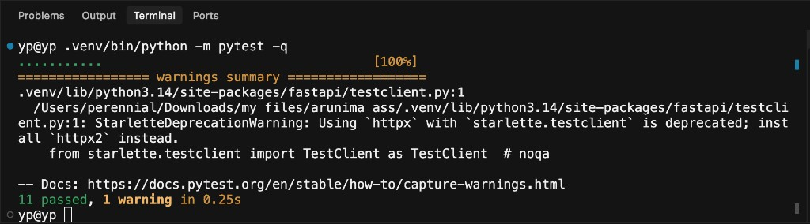 |
| REQ-02 | Automates a platform-engineering task end to end | Incident triage is the chosen platform-engineering task. Both planted pages run from the alert through tools, a proposal, operator approval, a fresh metric read, and a verified result. `test_approval_is_verified_before_the_run_resolves` covers the charge page. The local platform in `world.py` is the system the agent operates, so the review needs no cloud account. Pointing those tools at a live metrics or deploy service is listed under What's next. | 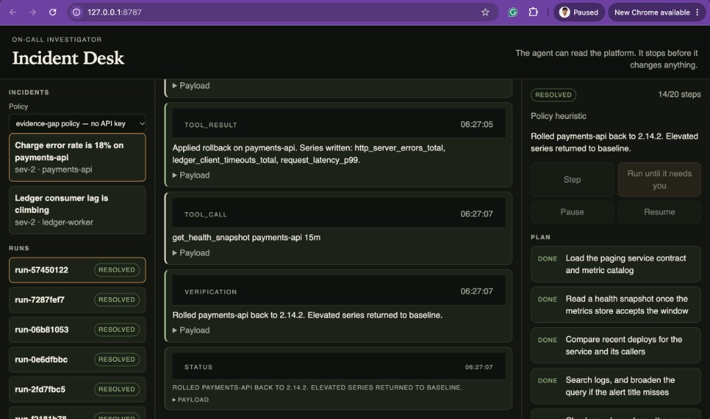 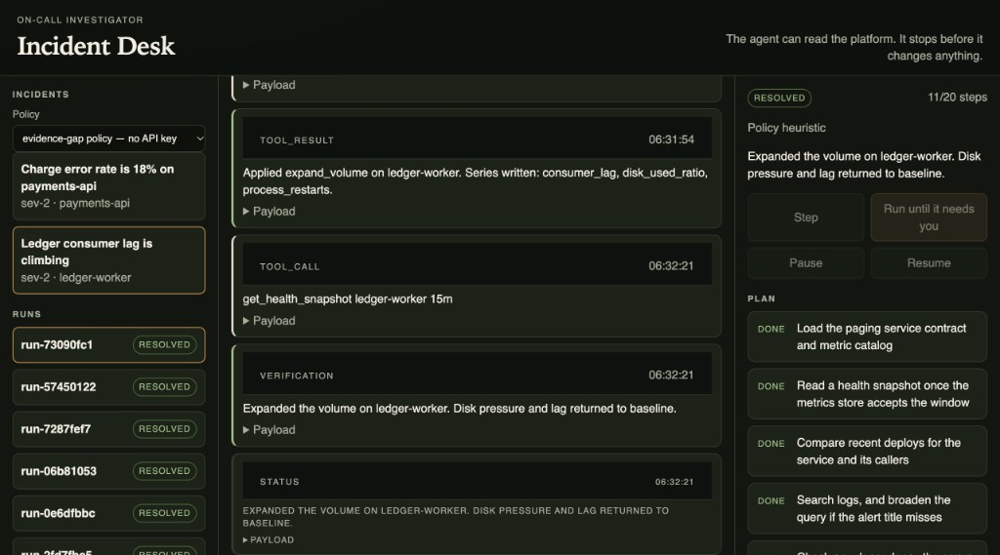 |
| REQ-03 | Web UI | `incident_desk/static/index.html`, `app.js`, and `styles.css`. Served at `GET /`. Console lists incidents, runs, timeline, plan, hypotheses, and the approval gate. | 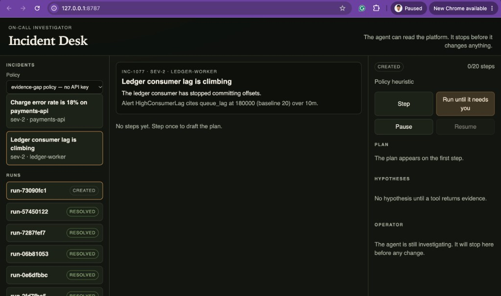 |
| REQ-04 | Backend APIs | `incident_desk/main.py` exposes `/api/health`, `/api/incidents`, `/api/tools`, `/api/runs`, advance, pause, resume, and intervene. OpenAPI is at `/docs`. | 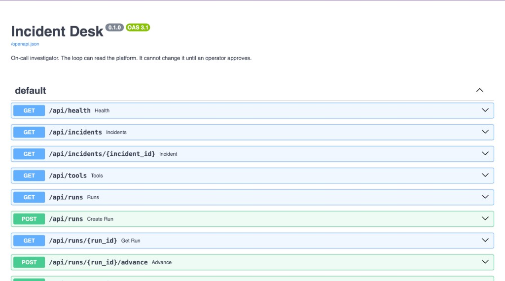 |
| REQ-05 | Local development setup | README install commands, Makefile targets `setup` / `test` / `dev` / `demo`, and `pyproject.toml`. `make dev` serves uvicorn on `127.0.0.1:8787`. No cloud credentials required. |  |
| REQ-06 | One use case from the allowed list | Incident triage for `inc-1042` (payments-api charge errors) and `inc-1077` (ledger disk). Log search and deploy history are tools inside that triage. |  |
| REQ-07 | Planning, not a scripted reply | `HeuristicPolicy.draft_plan` writes a six-step plan. `loop._refresh_plan` marks steps done, active, or pending from evidence already in memory. The console shows the plan. | 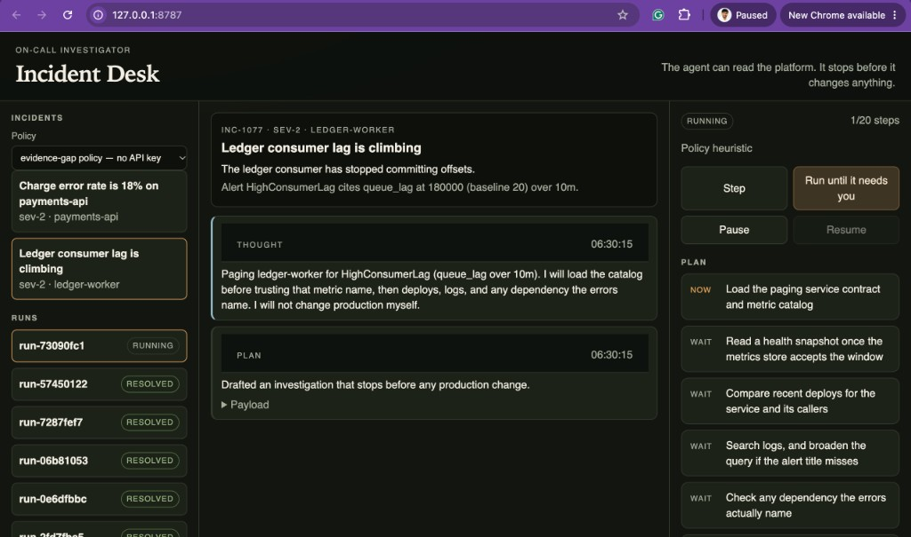 |
| REQ-08 | Tool use | `Policy.decide` picks the next tool from missing evidence. `Registry.call` dispatches `get_service`, `query_metrics`, `get_health_snapshot`, `list_recent_deploys`, `search_logs`, and `get_runbook`. Tests assert the charge page queries `edge-gateway` and the disk page does not. | 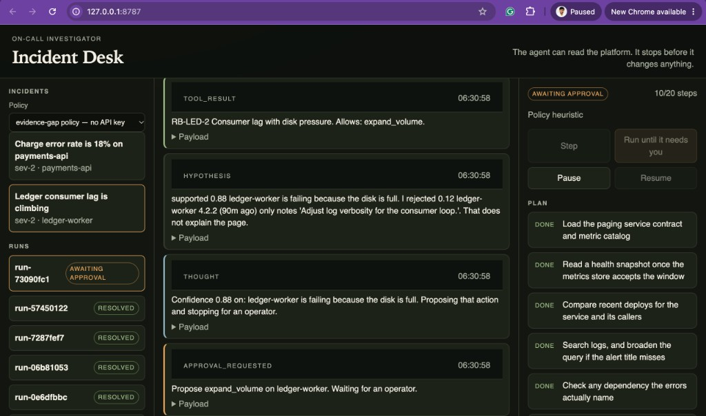 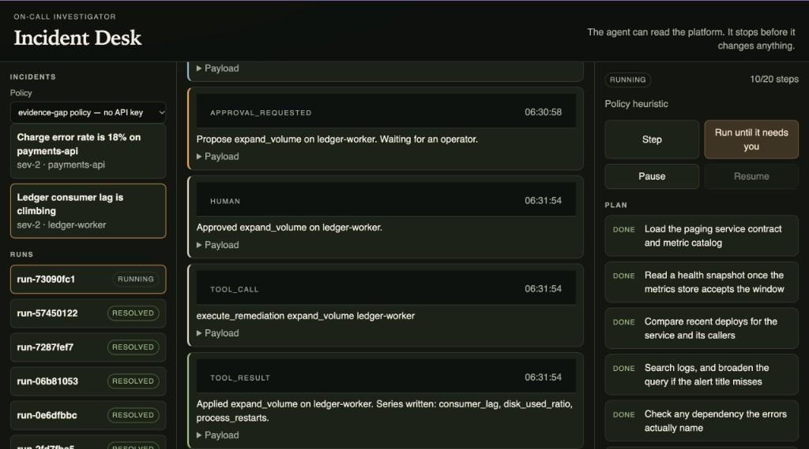 |
| REQ-09 | Error recovery | Alert window `10m` is rejected and retried at `15m`. A log search for the alert title misses, then a snapshot word is used. Failed argument pairs are not repeated. A policy call to `execute_remediation` is rewritten. LLM transport or JSON failures fall back to the evidence-gap policy. A failed verification bans the action. | 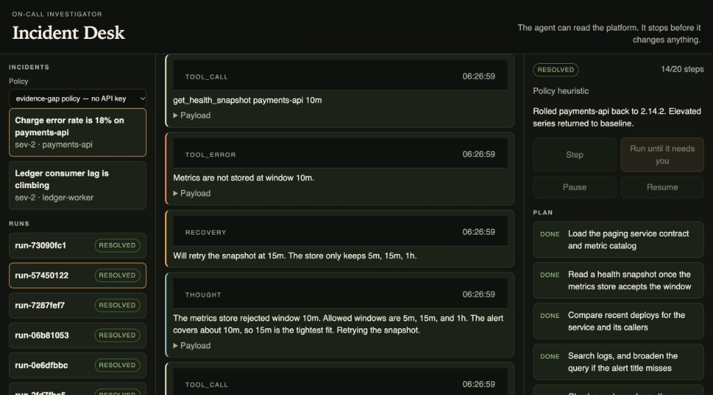 |
| REQ-10 | Human in the loop | `propose_remediation` sets `awaiting_approval`. `execute_remediation` is absent from the tools the loop may call; only `approve()` calls `Platform.execute`. Reject requires a note and bans the action. A hint names the next proposal and does not approve it. | 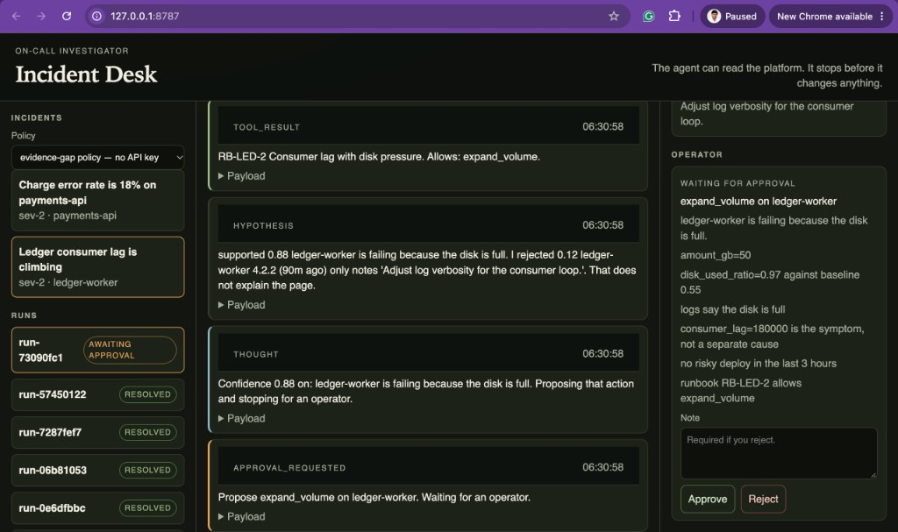  |
| REQ-11 | Not a chatbot wrapper | The default policy never calls a model. Hypotheses and confidence are scored in `reasoning.derive_hypotheses` from tool results. The runtime refuses an early proposal. One step is one thought plus at most one tool call, then a save. | 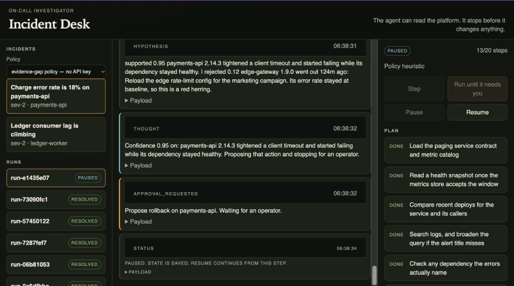 |
| REQ-12 | State and context survive steps and can be resumed | `store.py` keeps one JSON document per run in SQLite. Pause stores `resume_status`, including `awaiting_approval`. `test_pause_and_a_new_store_resume_the_same_run` opens a second `Store` on the same file and continues. The console reloads `GET /api/runs/{id}`. |  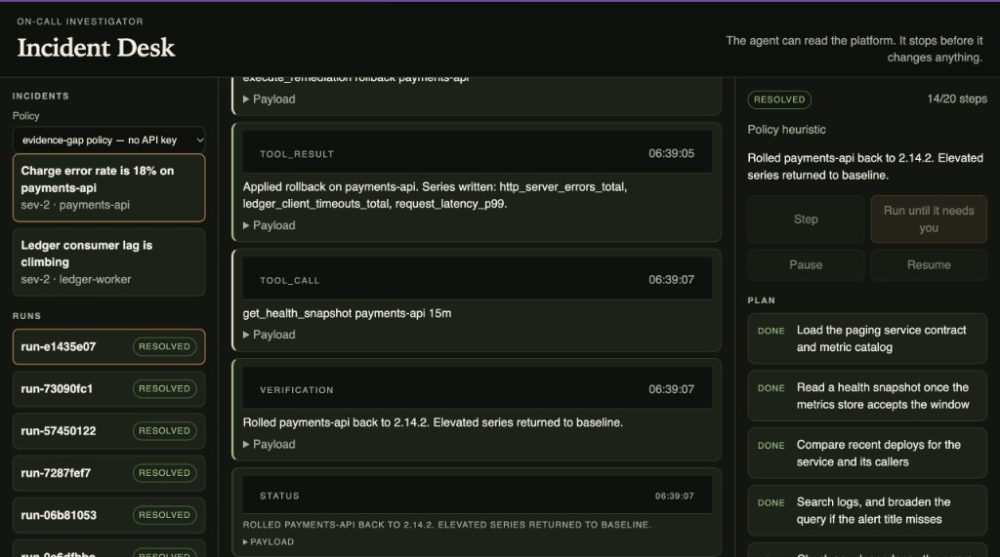 |
| REQ-13 | UI where an operator can watch the agent think | `app.js` renders thought, tool call, tool result, tool error, recovery, hypothesis, and replan events, plus the plan and hypothesis scores. Step advances one thought. Run until it needs you stops on a gate. |  |
| REQ-14 | UI where an operator can intervene | The gate offers Approve, Reject (note required), and Send hint. Pause and Resume are separate controls. After approval the UI tells the operator to step once so verification runs. |  |
| REQ-15 | API exposes the agent runtime | `POST /api/runs/{id}/advance` returns `{ applied, reason, run }`. pause, resume, and intervene change status. `create_run` selects heuristic or llm. `Desk.advance` persists after every step. |  |
| REQ-16 | API exposes tools | `GET /api/tools` returns name, description, arguments, `mutates`, and `requires_approval`. `execute_remediation` is listed with `requires_approval` true. `test_http_lists_tools_and_steps_a_run` asserts that. | 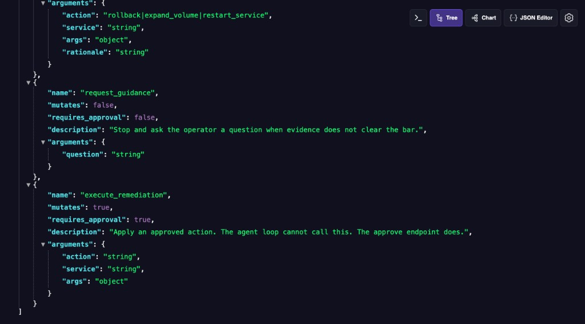 |
| REQ-17 | API exposes agent state | `GET /api/runs` returns summaries. `GET /api/runs/{id}` returns the full run: plan, events, hypotheses, proposal, memory, and overlay. | 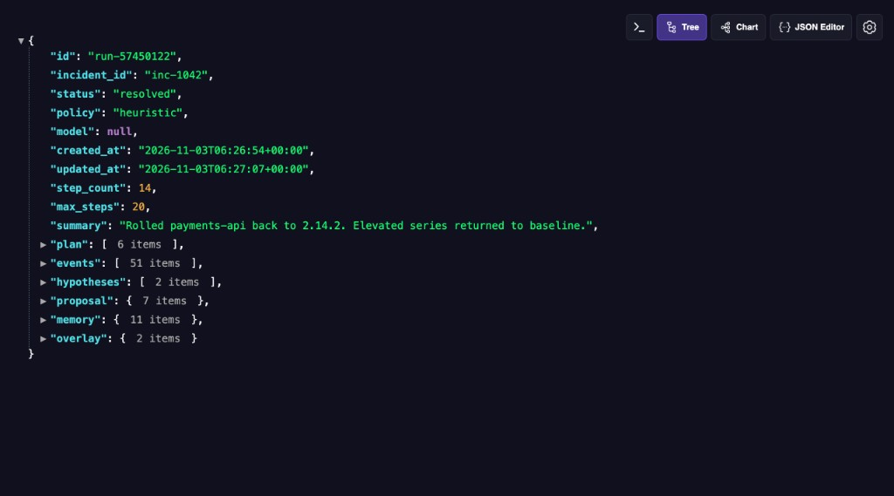 |
| REQ-18 | Working application | pytest: 11 passed. The suite drives both incidents, approval, a bad hint, a tampered rollback version, pause across a new SQLite connection, the mutation guard, and one HTTP step. |  |
| REQ-19 | README: setup | `README.md`: venv, editable install, pytest, uvicorn, and the Makefile equivalents. | Not captured. |
| REQ-20 | README: use-case rationale | Use case section explains why the first minutes of a page are a search, names both planted incidents, and states what the agent must not do. | 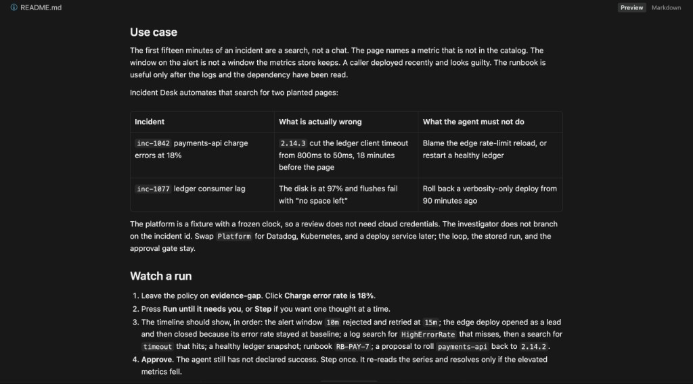 |
| REQ-21 | README: design decisions | Design section covers the step as the unit of autonomy, hypothesis scoring owned by the runtime, gap-driven tool choice, recovery, and the approval boundary. | 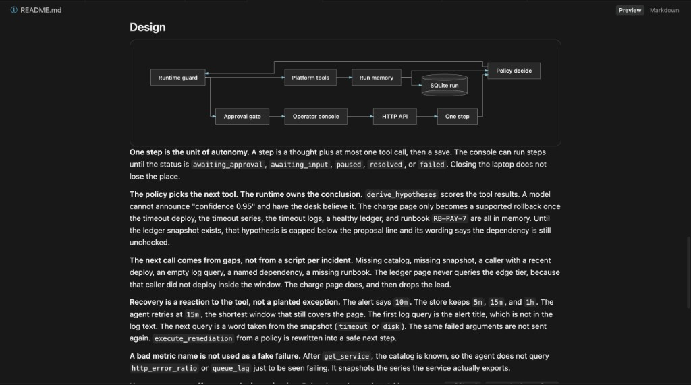 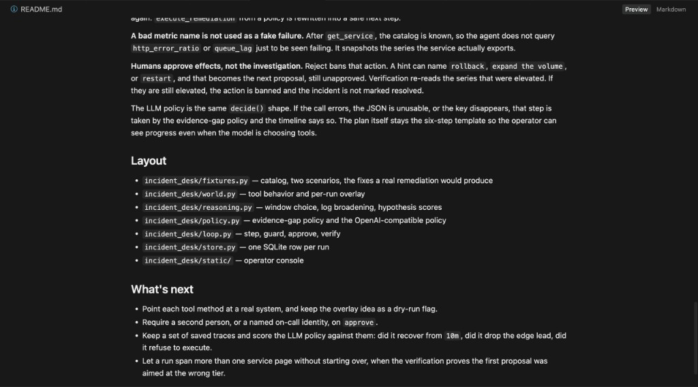 |
| REQ-22 | README: what is next | What's next: point tools at real systems, require a second approver, score the LLM policy against saved traces, and let one run span more than one page. |  |
| REQ-23 | Public GitHub repository | `git rev-parse` reports that this directory is not a git repository. No remote is configured. | [Repo](https://github.com/yagnikpokal/Incident-desk). |
| REQ-24 | Meaningful git history showing how the solution evolved | No `.git` directory. `AI_TRANSCRIPT.md` says commits were sliced into platform, loop, API, tests, and docs. That history is not in this tree. | Not captured. |
| REQ-25 | Complete AI interaction log of how AI tools were used to build it | `AI_TRANSCRIPT.md` is the full record of the Cursor session with Grok 4.7. It covers the opening request, the rejected use cases, the design decisions, the correction to the charge claim, and the eleven tests that closed the session. No other chat was used. | 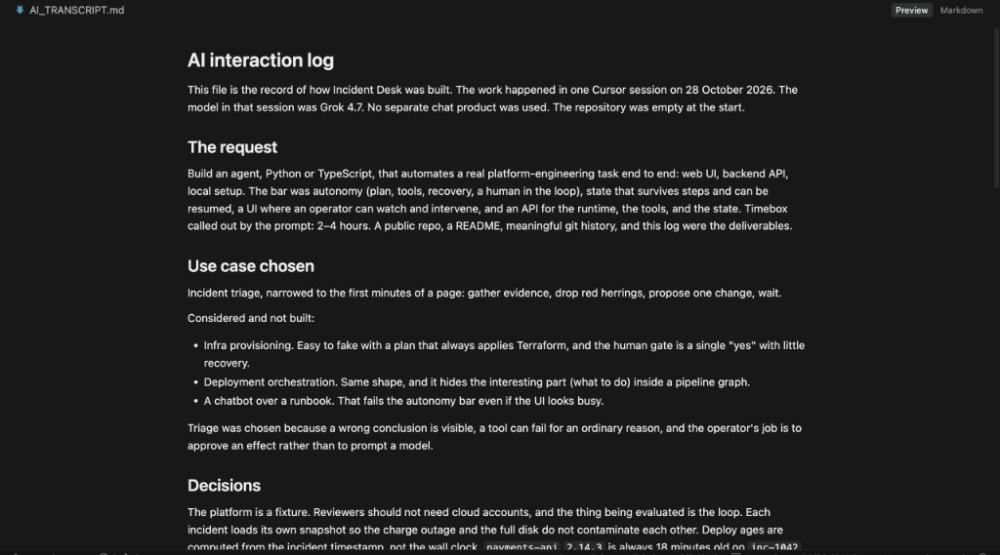 |
| REQ-27 | AI usage required while building | The build session used Grok 4.7 in Cursor, and `AI_TRANSCRIPT.md` is that record. The running desk does not require a model key. The evidence-gap policy is the default, and the optional LLM policy uses the same `decide()` shape when a key is set. |  |

## Open gaps, in review order

1. **Publish the repo (REQ-23).** The brief asks for a public GitHub repository. This folder has no remote and is not a git checkout.
2. **Keep a real history (REQ-24).** Separate commits for the platform, the loop, the API and console, the tests, and the docs. Squashing that into one commit would not meet the wording.
